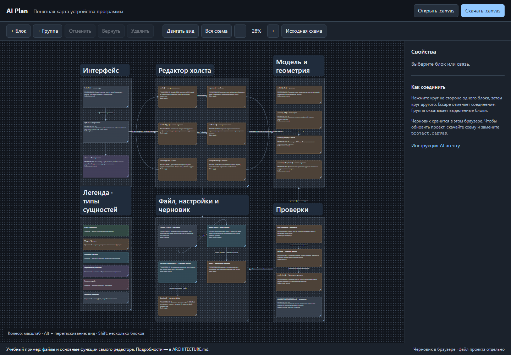

# AI Plan

**Понятная карта устройства программы.** Локальный холст с группами, цветными блоками и подписанными стрелками: от общего обзора систем до конкретных классов, скриптов и данных.

AI Plan помогает человеку понимать код, который создаётся вместе с AI агентом, на любом языке. Карту можно вести и вручную. Агент работает с обычным файлом `.canvas` по [инструкции](AI_AGENT_INSTRUCTIONS.md); встроенная нейросеть, API-ключ и облачный аккаунт не нужны.

## Быстрый запуск

1. Скачайте папку проекта с GitHub и распакуйте архив.
2. Откройте **[index.html](index.html)** двойным щелчком.
3. На холсте уже есть небольшой пример архитектуры самого AI Plan: интерфейс, редактор, модель, хранение и проверки. Описание — в [ARCHITECTURE.md](ARCHITECTURE.md).

Для использования не нужны установка, сборка, сервер или интернет. Node.js нужен только для служебных скриптов разработки.



## Как читать карту

- **Группа** — система или зона ответственности: например, «Инвентарь» или «Сеть».
- **Блок** — отдельная сущность: класс, модуль, функция, структура, таблица или enum. Внутри — точное имя, русское назначение, статус и путь к исходнику.
- **Цвет** — тип сущности. Расшифровка находится на самом холсте в группе «Легенда».
- **Стрелка внутри группы** — связь конкретных сущностей.
- **Стрелка между группами** — взаимодействие систем. Подпись объясняет, что передаётся и зачем.

Цвета и текст можно менять. Легенда служит пояснением: её изменение само по себе не перекрашивает остальные блоки.

## Основные действия

| Действие | Управление |
|---|---|
| Добавить сущность | «+ Блок», затем текст и цвет справа |
| Сгруппировать | Выделить блоки → «+ Группа» |
| Выбрать несколько | Shift + щелчок или рамка по пустому месту |
| Перенести / изменить размер | За заголовок / нижний правый угол |
| Создать связь | Круг на стороне первого блока или группы → круг второго |
| Подписать связь | Выбрать линию → свойства справа |
| Приблизить / отдалить | Колесо или кнопки −/+ |
| Переместить вид | Alt + перетаскивание, средняя кнопка или «Двигать вид» |
| Отменить / вернуть | Ctrl+Z / Ctrl+Shift+Z вне текстового поля |
| Сохранить | «Скачать .canvas» или Ctrl+S |

Названия групп увеличиваются относительно содержимого до масштаба **23%**. При дальнейшем отдалении они уменьшаются вместе с картой, чтобы не разрастаться поверх соседних систем.

## Сохранение

Основной файл примера — **[project.canvas](project.canvas)**. «Скачать .canvas» отправляет новый файл в загрузки: замените им файл вашей карты. Браузерный черновик хранится отдельно в текущем профиле; другой браузер или очистка данных могут сделать его недоступным.

Черновик AI Plan использует отдельный ключ. Копия не читает черновики других редакторов. «Открыть .canvas» позволяет загрузить актуальный файл; «Исходная схема» возвращает включённый пример с возможностью отмены.

## Работа с AI агентом

В корне есть [AGENTS.md](AGENTS.md), который направляет агента к [AI_AGENT_INSTRUCTIONS.md](AI_AGENT_INSTRUCTIONS.md). Для агента, не читающего AGENTS.md автоматически, передайте эту инструкцию явно:

> Прочитай AI_AGENT_INSTRUCTIONS.md. Покажи архитектуру моего проекта в project.canvas: системы группами, сущности отдельными блоками, типы цветами с легендой. Внутренние связи — между блоками одной системы, межсистемные — между группами. Пиши пояснения по-русски и отличай план от реализованного кода.

После изменения JSON агентом обновите стартовый пример:

```sh
node sync-example.cjs
node verify.cjs
```

Затем заново откройте файл в редакторе или обновите страницу. Уже открытая вкладка не синхронизируется с диском автоматически. Если в ней есть нужные правки, сначала сохраните их.

## Формат и границы

Поддерживаются текстовые узлы, группы и связи подмножества JSON Canvas 1.0. Файловые и ссылочные узлы не поддерживаются и отклоняются при импорте. Редактор не сканирует исходники и не генерирует код: за точность карты отвечает человек или работающий с файлами агент.

## Разработка и GitHub

Папка самостоятельна: в неё не нужно копировать исходный проект, из которого был выделен редактор. Здесь находятся только инструмент, демонстрационная карта, инструкции и проверки.

- [Как устроен редактор](ARCHITECTURE.md).
- [Как вносить изменения](CONTRIBUTING.md).
- [Как проверять](TESTING.md).
- [История изменений](CHANGELOG.md).

Для GitHub создайте репозиторий, например `ai-plan`, и загрузите содержимое этой папки в его корень. Команды создания репозитория и публикации в этой копии не выполнялись.
